# Avenzi — Implementação (Projeto Semestral de POO)

Sistema web de comércio eletrônico de produtos impressos em 3D, feito em **Python + Flask**,
seguindo o diagrama de classes da Atividade 4.

## Como executar

1. Instale o Python 3.10 ou mais novo (python.org). Na instalação, marque **"Add Python to PATH"**.
2. Dê dois cliques em `executar.bat`. Ele instala o Flask e inicia o sistema.
   (Ou, no terminal: `pip install flask` e depois `python app.py`.)
3. Abra **http://localhost:5000** no navegador.

Login do administrador criado automaticamente: **admin@avenzi.com** / **admin123**.
Para comprar, crie uma conta de cliente em "Criar conta".

Os dados ficam salvos no arquivo `dados.json`. Para começar do zero, apague esse arquivo.

## Organização do código

| Arquivo | O que tem |
|---|---|
| `modelo/usuario.py` | `Usuario` (abstrata), `Cliente`, `Administrador` |
| `modelo/produto.py` | `Produto`, `Estoque` |
| `modelo/carrinho.py` | `Carrinho`, `ItemCarrinho` |
| `modelo/pedido.py` | `Pedido`, `ItemPedido`, `Pagamento`, `Entrega` |
| `modelo/validacao.py` | funções de validação (campo obrigatório, e-mail, CPF, senha) |
| `excecoes.py` | exceções personalizadas do sistema |
| `loja.py` | classe `Loja`: guarda os objetos, confere permissões e chama as classes do modelo |
| `repositorio.py` | classe `Repositorio`: salva e carrega tudo em JSON |
| `app.py` | rotas web do Flask: cada função é uma página ou ação |
| `templates/` | páginas HTML |
| `static/estilo.css` | visual responsivo (RNF01) |

O caminho de uma ação é sempre este: **página (formulário) → `app.py` (rota) → `Loja` → classes do modelo → `Repositorio` salva em JSON.**

> Nomes: no diagrama os métodos estão em camelCase (`calcularTotal`). No Python a convenção é snake_case (`calcular_total`). São os mesmos métodos.

## Onde está cada conceito de POO

### Herança (generalização/especialização)
`modelo/usuario.py`: `Cliente(Usuario)` e `Administrador(Usuario)`. Os dois herdam `id`, `nome`, `email`, `senha`, `ativo`, `autenticar()` e `atualizar_dados()`.
`Usuario` é **abstrata** (`ABC` + `@abstractmethod`), então não dá para criar um "usuário genérico".

### Polimorfismo
- `obter_permissoes()` é abstrato em `Usuario` e cada subclasse implementa de um jeito: o Cliente devolve permissões de compra e o Administrador devolve permissões de gestão.
- Onde é usado: `Loja.exigir_permissao()` (em `loja.py`) chama `usuario.possui_permissao(...)` **sem saber se é Cliente ou Administrador**. O Python chama a versão certa automaticamente. É assim que a **RN08** é garantida.
- Também em `base.html`: o menu muda conforme `usuario.eh_administrador()`, que depende de `obter_permissoes()`.

### Sobrecarga
O Python **não tem sobrecarga de métodos igual ao Java** (dois métodos com o mesmo nome e parâmetros diferentes). Se você escrever dois métodos com o mesmo nome, o segundo substitui o primeiro. O jeito Python de fazer sobrecarga é:

1. **Parâmetros opcionais**: o mesmo método aceita formas diferentes de chamada.
   - `Carrinho.adicionar_produto(produto)` adiciona 1 unidade; `Carrinho.adicionar_produto(produto, 3)` adiciona 3.
   - `Usuario.atualizar_dados(nome, email)` muda nome e e-mail; `Usuario.atualizar_dados(nome, email, nova_senha)` muda também a senha. As duas formas são usadas em `Loja.atualizar_meus_dados()`.
2. **Sobrecarga de operador**: `Produto.__eq__` redefine o que o `==` faz entre dois produtos (iguais quando têm o mesmo id). Usado em `Carrinho._buscar_item()`.

No diagrama atualizado (`diagrama_atualizado.puml`) as duas versões aparecem como métodos sobrecarregados, no estilo UML/Java.

### Associação, composição e multiplicidade
- **Composição**: `Carrinho.itens` (lista de `ItemCarrinho`) e `Pedido.itens` (lista de `ItemPedido`). Os itens são criados **dentro** do carrinho/pedido e não existem sozinhos.
- **Associação**: `Pedido.cliente`, `Cliente.pedidos`, `ItemPedido.produto`, `Produto.estoque`, `Pedido.pagamento` (0..1), `Pedido.entrega` (0..1), `Cliente.carrinho` (0..1).

### Encapsulamento
No diagrama os atributos são privados (`-`). No código isso é feito assim:

1. **Atributo privado com `_`**: `self._status`, `self._preco`, `self._quantidade_disponivel`... Em Python o `_` é a convenção para "privado, não mexa de fora da classe".
2. **Leitura com `@property` (getter)**: de fora dá para **ler** `pedido.status` ou `produto.preco`, como se fosse um atributo comum. As páginas HTML usam isso.
3. **Sem setter**: tentar **alterar** direto (`pedido.status = "Enviado"`) gera erro (`AttributeError`). Para mudar é obrigatório chamar o método da classe, que **valida antes**:

| Atributo | Só muda por | O que o método garante |
|---|---|---|
| `Estoque._quantidade_disponivel` | `atualizar_quantidade()` | nunca fica negativa |
| `Pedido._status` | `criar()`, `registrar_pagamento()`, `atualizar_status()`, `cancelar()` | ordem do processo, RN05 e RN06 |
| `Produto._ativo` | `ativar()` / `inativar()` | não ativa duas vezes; RN01 |
| `Produto._nome`, `_preco` | `alterar_dados()` | nome obrigatório, preço > 0 |
| `Usuario._nome`, `_email`, `_senha` | `atualizar_dados()` | e-mail válido, senha com 4+ caracteres |
| `ItemCarrinho._quantidade` | `alterar_quantidade()` | quantidade > 0 |
| `Usuario._id`, `Produto._id` | `definir_id()` | o id é dado uma única vez, pela `Loja` |

Exemplo para mostrar na apresentação (`modelo/pedido.py`): o status do pedido não pode "pular etapas", porque não existe outro caminho para mudá-lo além de `atualizar_status()`.

As referências dos relacionamentos (`pedido.cliente`, `pedido.itens`, `cliente.pedidos`...) ficaram públicas, porque representam as associações do diagrama e não guardam regra própria.

## Onde está cada regra de negócio

| Regra | Onde |
|---|---|
| RN01: produto inativo não pode ser comprado | `Produto.consultar()`, chamado em `Carrinho.adicionar_produto()` e `Pedido.criar()`; a vitrine também esconde inativos (`Loja.pesquisar_produtos`) |
| RN02: pedido com pelo menos um produto | `Pedido.criar()` |
| RN03: quantidade não pode passar do estoque | `Carrinho.adicionar_produto()` e `Pedido.criar()` |
| RN04: estoque atualizado após confirmar o pedido | `Pedido.criar()` (baixa) e `Pedido.cancelar()` (devolve) |
| RN05: preparação só após pagamento confirmado | `Pedido.atualizar_status()`, caso `EM_PREPARACAO` |
| RN06: pedido cancelado não pode ser enviado | `Pedido.atualizar_status()`, primeiro `if` |
| RN07: pedido associado a um cliente | `Pedido.criar()` |
| RN08: só o administrador gerencia | `Loja.exigir_permissao()`, usando polimorfismo |

## Tratamento de exceções

Em `excecoes.py`, todas as exceções herdam de `NegocioError`:

| Situação pedida no enunciado | Exceção | Exemplo no sistema |
|---|---|---|
| Dado obrigatório não informado | `DadosInvalidosError` | cadastro sem nome |
| Informação inválida | `DadosInvalidosError` | CPF com menos de 11 dígitos, preço negativo, "abc" na quantidade |
| Registro não encontrado | `RegistroNaoEncontradoError` | produto ou pedido inexistente |
| Falha ao salvar dados | `PersistenciaError` | erro ao gravar `dados.json` |
| Falha ao carregar dados | `PersistenciaError` | `dados.json` corrompido |
| Operação não permitida | `OperacaoNaoPermitidaError` | cliente acessando tela de admin, estoque insuficiente |
| Ação em estado incorreto | `EstadoInvalidoError` | enviar pedido cancelado, separar pedido sem pagamento |

**Onde são tratadas:** no final de `app.py`.
- `@app.errorhandler(NegocioError)` captura **qualquer** erro de negócio e mostra a mensagem em vermelho na tela.
- `@app.errorhandler(Exception)` captura erros inesperados e mostra só "Ocorreu um erro inesperado". O detalhe técnico vai para o terminal, **nunca para o usuário**.

Por isso as rotas não precisam de `try/except`: as classes lançam (`raise`) e o `app.py` trata em um só lugar.

## Persistência

`repositorio.py` usa **serialização em JSON**:
- `salvar()` transforma cada objeto em dicionário e grava em `dados.json`. Grava primeiro num arquivo temporário e depois troca, para não corromper o original.
- `carregar()` lê o arquivo e recria os objetos, religando os relacionamentos (o item do pedido guarda só `produto_id`, e no carregamento ele volta a apontar para o objeto `Produto`).
- A `Loja` chama `salvar()` depois de toda alteração.

## Roteiro de demonstração (processo principal)

1. Criar conta de cliente (testar CPF inválido → mensagem de erro).
2. Pesquisar e adicionar produtos ao carrinho (testar quantidade maior que o estoque → erro RN03).
3. Finalizar o pedido (o estoque diminui → RN04).
4. Sair, entrar como admin e abrir "Pedidos".
5. Tentar "Separar" antes de pagar → erro RN05. Registrar o pagamento com o valor total.
6. Separar → Enviar com código de rastreio → Concluir.
7. Cancelar outro pedido e tentar enviá-lo → erro RN06.
8. Em "Produtos e estoque": cadastrar, alterar, inativar (some da vitrine → RN01).
9. Fechar e abrir o sistema de novo: os dados continuam lá (persistência).

## Principais telas

Prints da aplicação rodando com dados de exemplo (pasta `telas/`).

| Tela | O que mostra |
|---|---|
| 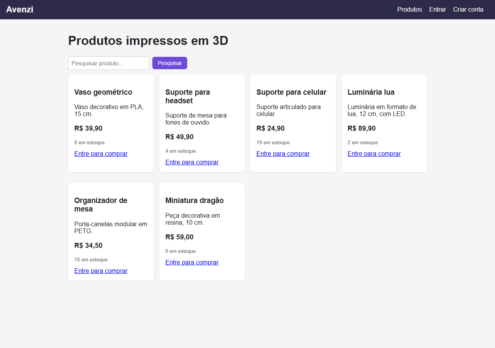 | **Vitrine (visitante)**: pesquisa de produtos (RF04). Produto inativo não aparece (RN01). |
| 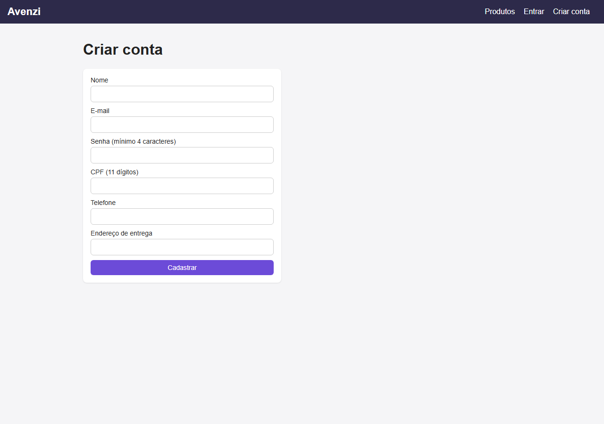 | **Criar conta**: cadastro de cliente com validação (RF01). |
| 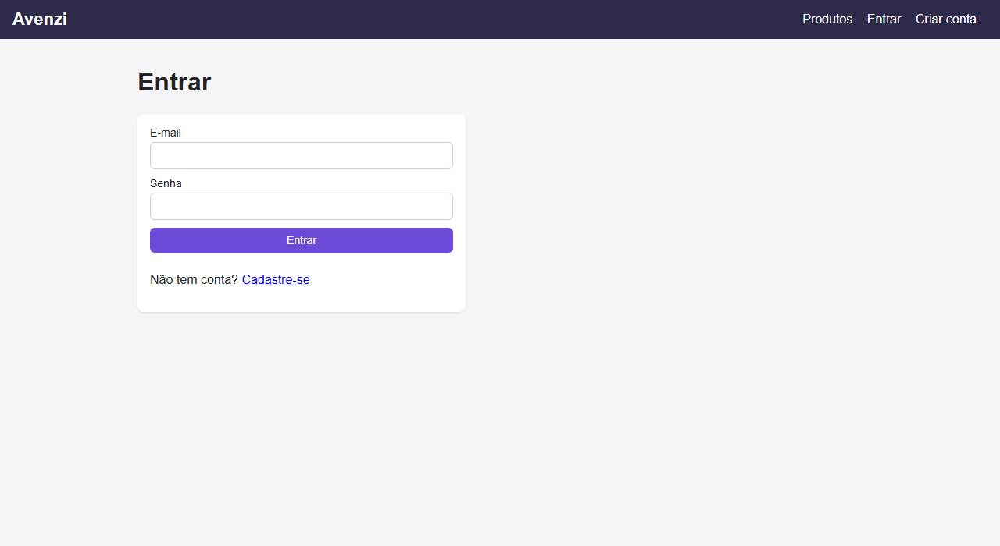 | **Login**: autenticação (RF02, RNF02). |
| 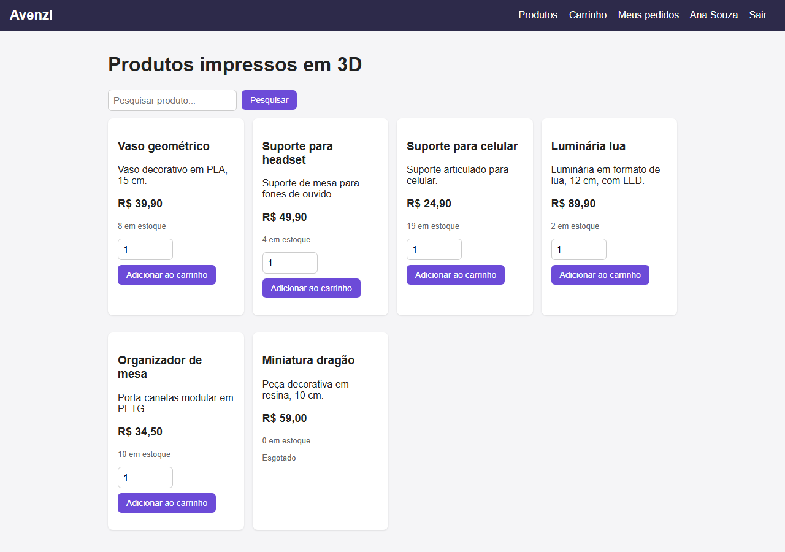 | **Vitrine (cliente logado)**: adicionar ao carrinho (RF05). Produto sem estoque aparece como "Esgotado". |
| 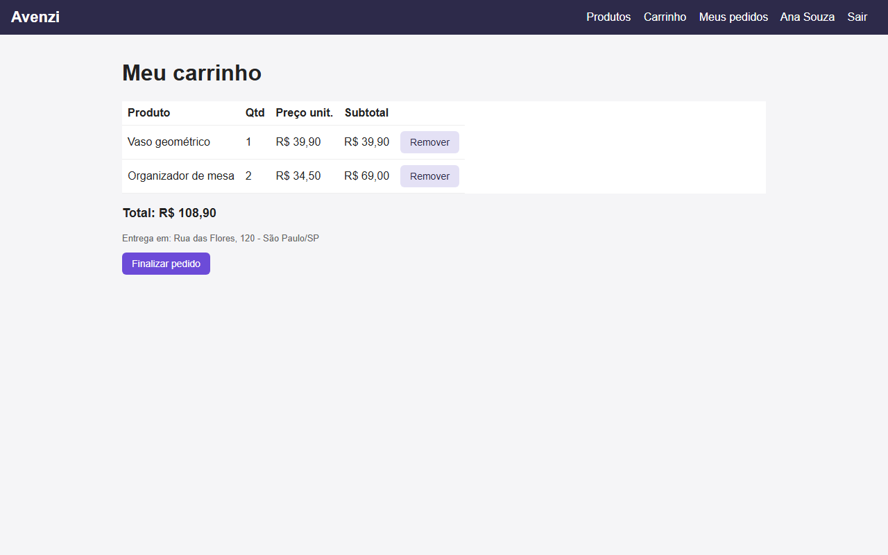 | **Carrinho**: itens, subtotais, total e "Finalizar pedido" (RF06). |
| 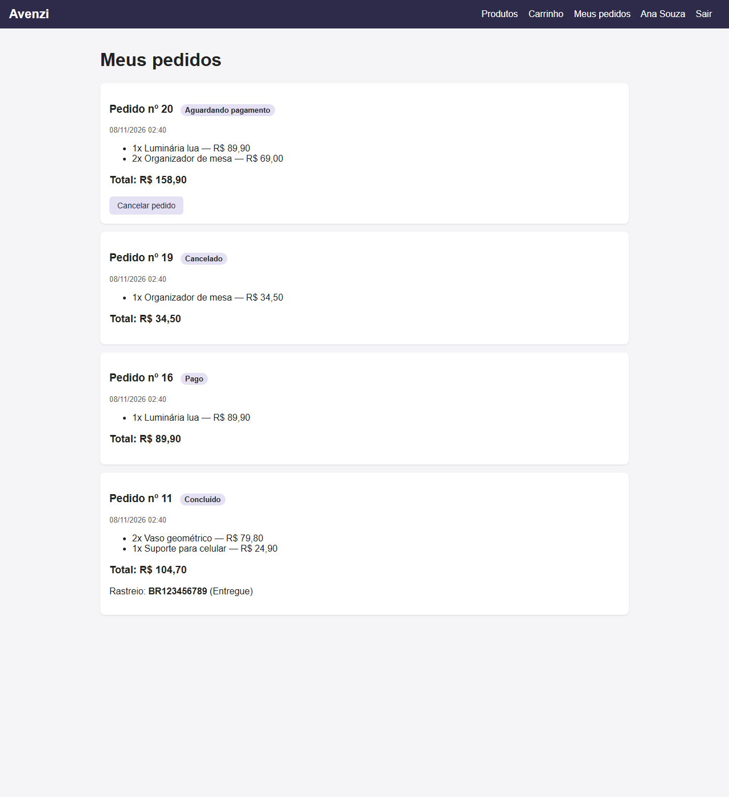 | **Meus pedidos**: o cliente acompanha o status e o rastreio. |
| 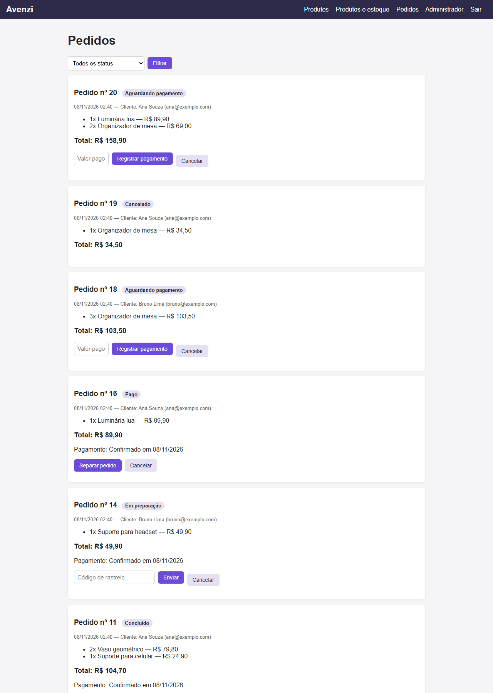 | **Pedidos (administrador)**: pagamento → separação → envio → conclusão, com os botões certos para cada status (RF07, RF09, RF10, RN05, RN06). |
| 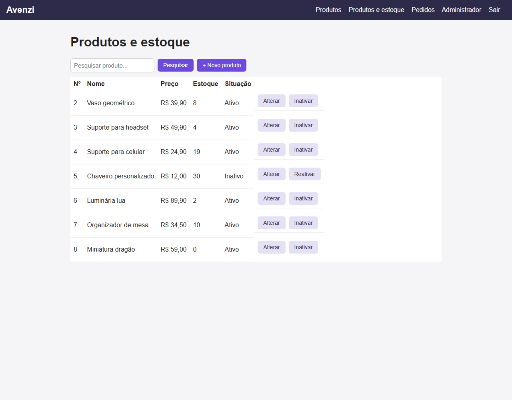 | **Produtos e estoque**: listar, alterar, inativar e reativar (RF03, RF08). |
| 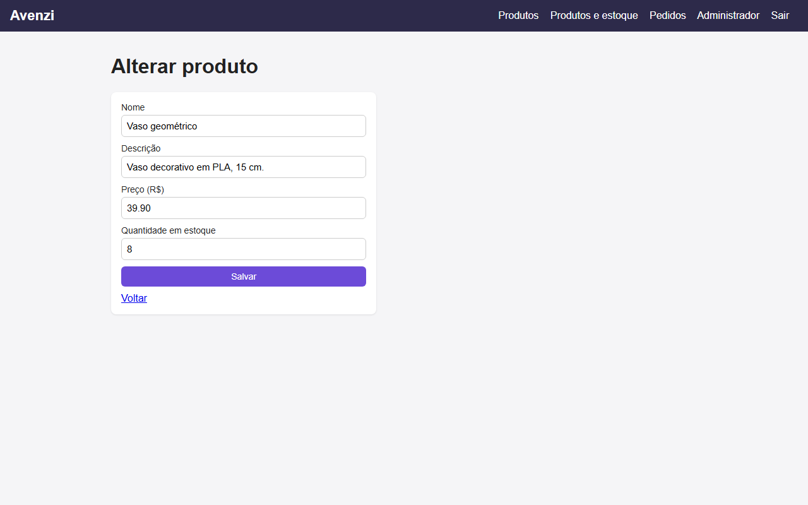 | **Formulário de produto**: alteração de registro. |
| 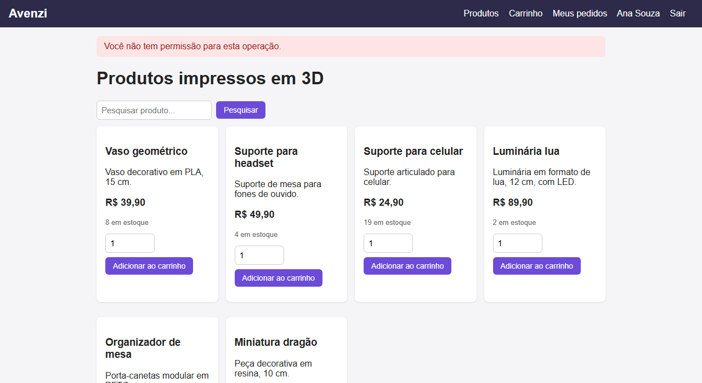 | **Erro: operação não permitida**: cliente tentando abrir a área do administrador (RN08). |
| 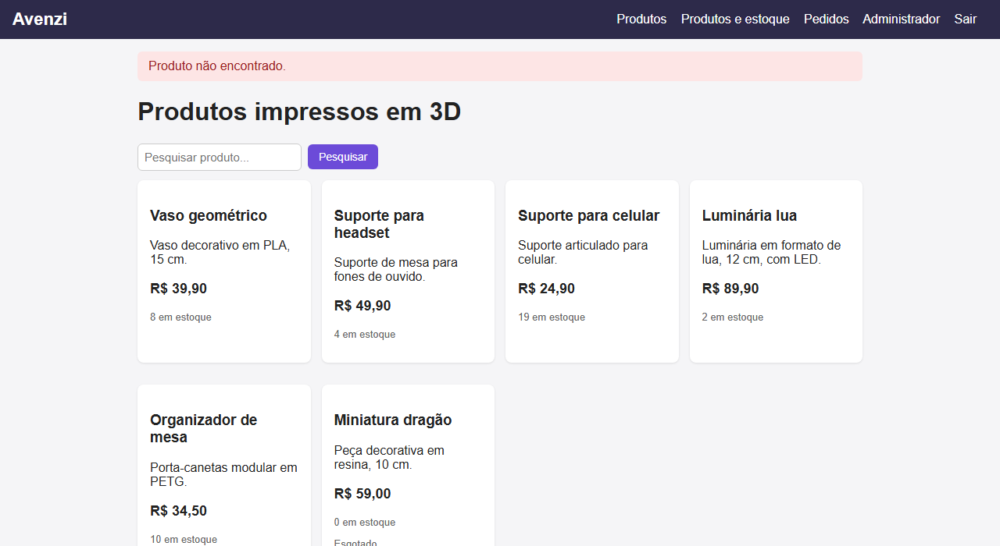 | **Erro: registro não encontrado**: mensagem amigável, sem detalhe técnico (RNF04). |
| 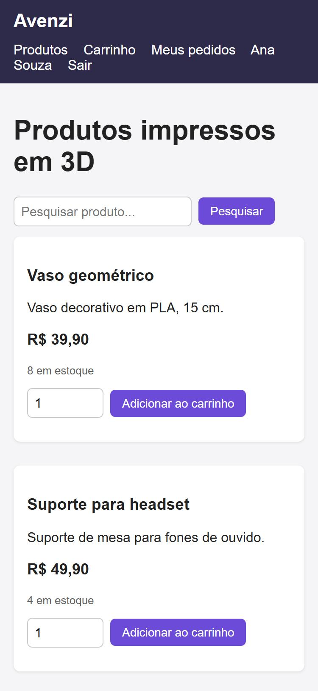 | **Celular**: layout responsivo (RNF01). |

## Mudanças em relação ao diagrama da Atividade 4

- `Administrador.consultar_pedidos(pedidos)` e `consultar_estoque(produtos)` passaram a receber a lista por parâmetro.
- Novo método `Produto.ativar()` (reativar produto inativado).
- Novos `Usuario.possui_permissao()`, `Cliente.obter_carrinho()` e `Carrinho.esvaziar()`.
- Novos `Usuario.definir_id()` e `Produto.definir_id()`: o id só é dado depois que os dados foram validados (encapsulamento).
- Novo `ItemCarrinho.alterar_quantidade()`: a quantidade do item só muda por ele.
- Novo `Pedido.registrar_pagamento(pagamento)`: o pedido confere o próprio estado antes de aceitar o pagamento (não aceita pagamento de pedido cancelado).
- Novas classes de apoio: `Loja` (coordena as operações) e `Repositorio` (persistência).
- O diagrama atualizado está em `diagrama_atualizado.puml`. Para gerar a imagem, cole o conteúdo em https://www.plantuml.com/plantuml.
